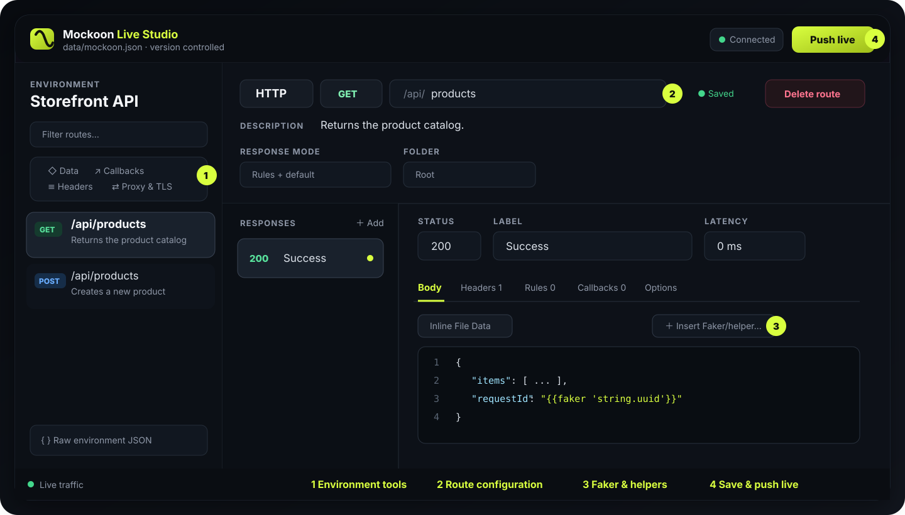
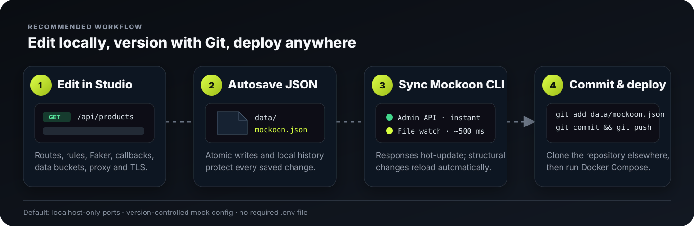

# Mockoon Live Studio

A self-hosted web editor for Mockoon environment files. It uses Mockoon's native environment JSON model, saves changes atomically, keeps local version history, and synchronizes them to a running Mockoon CLI.

## Mockoon Desktop compatibility

You can export an environment from Mockoon Desktop and either import it in Live Studio or map the same JSON file into the Compose stack. Live Studio preserves unknown properties so a file can move back to Desktop without stripping fields added by newer Mockoon releases.

The visual editor covers the current CLI environment model:

- HTTP, CRUD, and WebSocket routes, all Mockoon HTTP methods, response modes, default responses, and streaming settings
- Inline, file, and data-bucket bodies; Handlebars/Faker helper insertion
- Response headers, all rule targets/operators, AND/OR matching, inversion, and rule ordering
- Folders, data buckets, callbacks and callback invocations
- Environment headers, latency, automatic CORS, proxy headers/settings, TLS, hostname, port, and endpoint prefix
- Import/export, raw JSON fallback, automatic snapshots, restore, and live traffic logs

The raw JSON editor is retained for forward compatibility. Properties unknown to this Live Studio build remain untouched.

## Interface overview



1. Use the environment tools to manage data buckets, callbacks, shared headers, proxy settings, and TLS.
2. Select or create a route, then configure its type, HTTP method, endpoint, response mode, and folder.
3. Edit response bodies, headers, matching rules, callbacks, and options. The helper menu inserts Faker and request templates.
4. Changes autosave to `data/mockoon.json`. **Push live** sends supported changes to the Admin API immediately; CLI file watching reloads structural changes automatically.

## Quick start

1. Clone the repository and enter its directory.
2. Run `docker compose up -d --build --wait`.
3. Open Live Studio at `http://127.0.0.1:4173`.
4. Open the mock API at `http://127.0.0.1:3000/api/products`.
5. Edit the environment in Live Studio, verify the mock response, then commit `data/mockoon.json` when ready.



The repository defaults work without a `.env` file. Create one from `.env.example` only when you need different ports, a different config directory, or a custom Admin API token.

## Start

Requires Node.js 20+. The Compose stack is tested and pinned to Mockoon CLI `9.9.0`.

```powershell
npm start
```

This opens the repository's `data/mockoon.json` by default. Open `http://127.0.0.1:4173`.

To override the file or connect to a separately running CLI:

```powershell
$env:MOCKOON_DATA_FILE = 'D:\path\to\another-mockoon.json'
$env:MOCKOON_ADMIN_URL = 'http://127.0.0.1:3000'
$env:MOCKOON_ADMIN_TOKEN = 'your-admin-token'
npm start
```

You can also configure the Admin URL and token from **Environment settings**. The token stays in server memory and is never written to disk.

## Run Mockoon CLI

```powershell
mockoon-cli start --data .\data\mockoon.json --watch
```

Mockoon CLI's Admin API is enabled by default. It can hot-update response content and several environment settings, but Mockoon itself cannot hot-patch route paths/methods, newly added routes, data buckets, or callbacks. Use `--watch` for these structural changes; it automatically restarts the mock when the environment file changes.

## Docker Compose (recommended)

The included Compose stack starts both services:

- `studio`: this browser editor on `http://127.0.0.1:4173`
- `mockoon`: the official Mockoon CLI image on `http://127.0.0.1:3000`

Start the stack directly with the repository defaults:

```powershell
docker compose up -d --build --wait
```

Copy `.env.example` to `.env` only when you want to override the defaults.

The default setup uses the version-controlled `data/mockoon.json`. No environment variable or `.env` file is required for the default repository layout. To use another config, edit `.env`:

```dotenv
MOCKOON_CONFIG_DIR=D:/mocks/store-api
MOCKOON_CONFIG_FILE=mockoon.json
MOCKOON_ADMIN_API_TOKEN=replace-with-a-long-random-token
```

Mockoon CLI defaults to the pinned `9.9.0` image even when no `.env` file exists. To upgrade deliberately, change `MOCKOON_CLI_VERSION` in `.env`, review the Mockoon migration notes, and test the exported environment before changing the default in `compose.yaml`.

`MOCKOON_CONFIG_DIR` must be the directory containing the JSON file, not the JSON file itself. Both containers mount this directory at `/data`: Studio needs write access while Mockoon CLI only receives a read-only mount. Mounting the containing directory also allows Studio's atomic save operation to replace the JSON file safely.

Useful commands:

```powershell
# View status and health
docker compose ps

# Follow both services
docker compose logs -f

# Stop the stack without deleting version history
docker compose down

# Stop and remove the Studio history volume
docker compose down -v
```

Studio saves the mapped JSON file first, then sends it to the Mockoon Admin API. `MOCKOON_AUTO_PUSH=true` is enabled in Compose, so supported response changes are applied immediately. The Compose stack also runs CLI with `--watch --polling-interval 500`; structural changes restart the mock automatically, normally within about half a second. Docker port publishing remains controlled by Compose, so port, hostname, and TLS changes may still require adjusting Compose and restarting the container:

```powershell
docker compose restart mockoon
```

Both published ports bind to `127.0.0.1` by default. If you change either bind address to `0.0.0.0`, place Studio behind authentication and TLS and replace the default Admin API token first.

## Build or run only the Studio image

```powershell
docker build -t mockoon-live-studio .
docker run --rm -p 4173:4173 `
  -e MOCKOON_DATA_FILE=/data/mockoon.json `
  -e MOCKOON_ADMIN_URL=http://host.docker.internal:3000 `
  -e MOCKOON_ADMIN_TOKEN=your-admin-token `
  -v D:/mocks/store-api:/data `
  mockoon-live-studio
```

## Environment variables

| Variable | Default | Purpose |
| --- | --- | --- |
| `MOCKOON_CLI_VERSION` | `9.9.0` | Pinned Mockoon CLI Docker image version |
| `MOCKOON_CONFIG_DIR` | `./data` | Host directory mounted by Compose |
| `MOCKOON_CONFIG_FILE` | `mockoon.json` | Environment filename used by Compose |
| `MOCKOON_DATA_FILE` | `data/mockoon.json` | Environment JSON to edit |
| `MOCKOON_ADMIN_URL` | `http://127.0.0.1:3000` | Running mock base URL |
| `MOCKOON_ADMIN_TOKEN` | empty | Admin API bearer token |
| `MOCKOON_AUTO_PUSH` | `false` | Push after every save |
| `STUDIO_HOST` | `127.0.0.1` | Studio bind address |
| `STUDIO_PORT` | `4173` | Studio port |
| `STUDIO_HISTORY_DIR` | `.history` | Directory containing automatic snapshots |

### Is `MOCKOON_ADMIN_API_TOKEN` required?

No, Mockoon can run its Admin API without a token. It is strongly recommended whenever the Admin API is reachable by anything other than your own machine. The Compose example configures a token by default and shares it only between the two containers. If you intentionally remove it, update the Compose health check and Studio setting consistently.

## Safety

- The server binds to localhost by default.
- Saves use a temporary file plus atomic rename.
- The previous file is copied to `.history/` before each save.
- Unknown Mockoon properties are preserved, and the Raw JSON editor is available for advanced features.
- If exposing the Studio beyond localhost, place it behind authentication and TLS.
